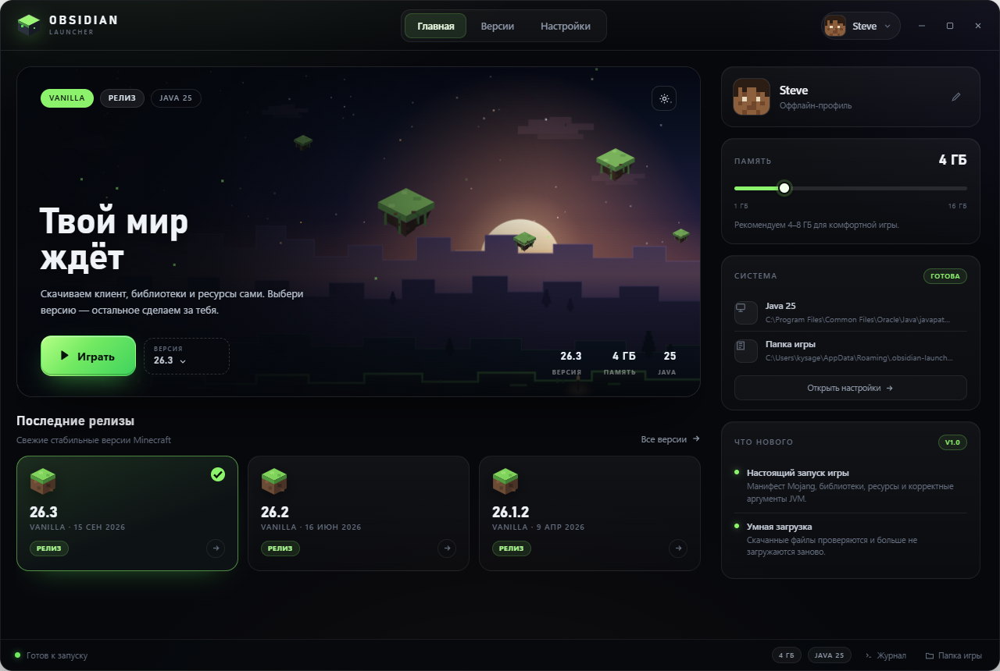
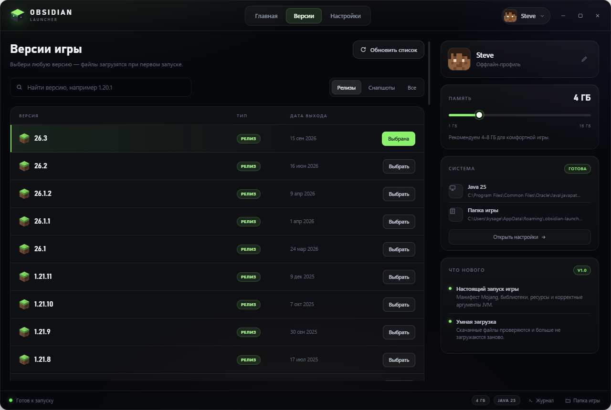
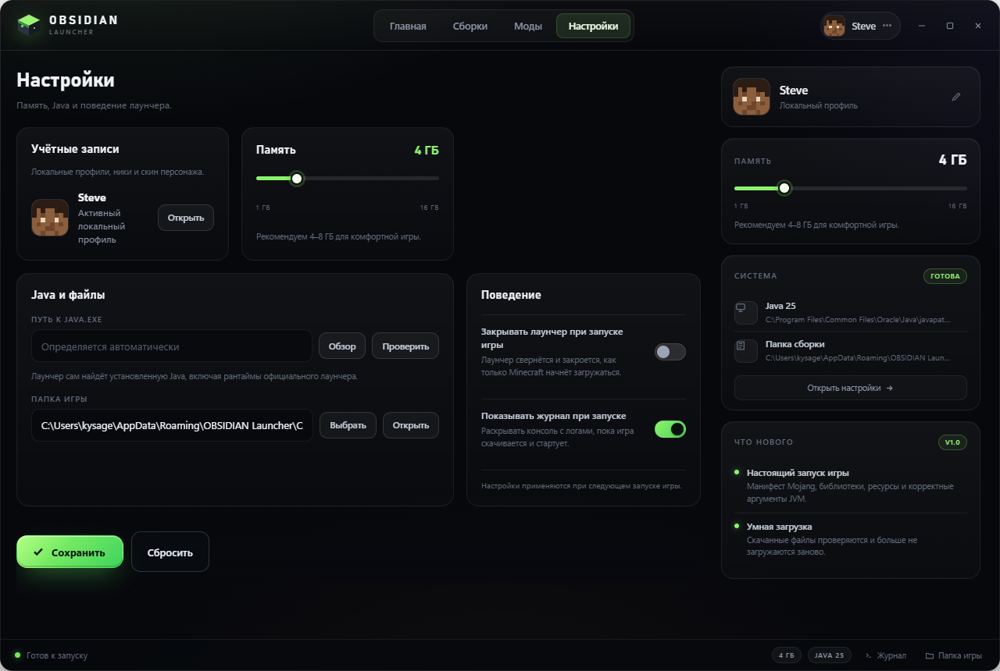
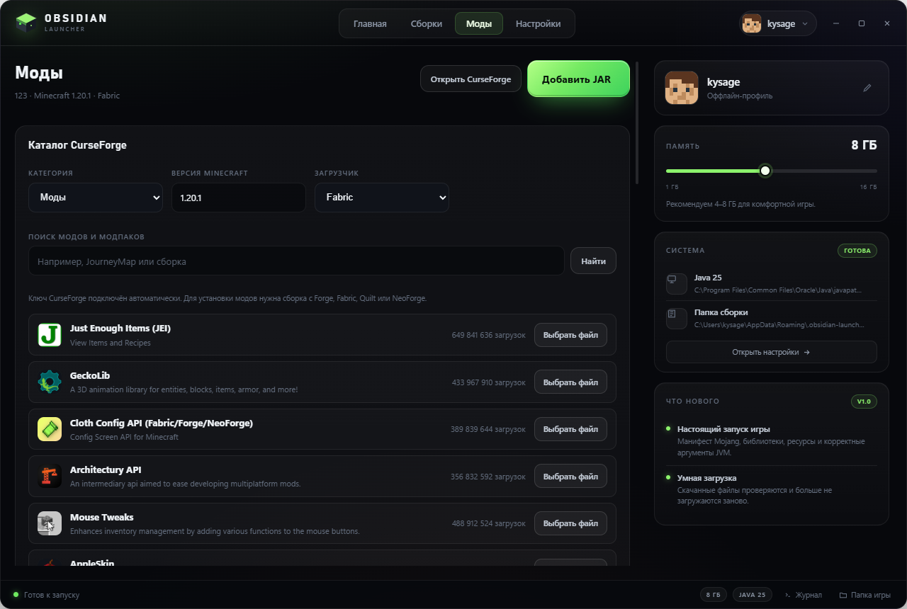

# OBSIDIAN Launcher

Лаунчер Minecraft с отдельными профилями игры, установкой загрузчиков и модов, загрузкой файлов Mojang и запуском игры.



## История версий

### 1.0.1

- Добавлены отдельные профили сборок с собственными папками, версией Minecraft и загрузчиком.
- Добавлены создание и настройка сборок, переключение активного профиля и переход к его модам.
- Добавлены CurseForge: поиск модов и готовых сборок, установка модов с проверкой файлов и импорт модпаков.
- Добавлена поддержка Fabric, Quilt и NeoForge наряду с Forge и Vanilla.
- Улучшены фильтры и сортировка каталога; исправлено сохранение режима готовых сборок при поиске и сортировке.
- Добавлены проверка обновлений из приложения, уведомление о новой версии и установка обновления.
- Добавлены настройки Java и памяти, управление загрузкой, офлайн-скин и улучшения интерфейса.

### 1.0.0

- Первая опубликованная версия лаунчера с запуском Minecraft, офлайн-профилем, установкой Forge, настройками и журналом игры.

## Возможности

- **Настоящий запуск Minecraft** — манифест версий, клиент, библиотеки, нативные библиотеки, ресурсы и корректные аргументы JVM/игры.
- **Сборки как в Prism Launcher** — создай профиль с именем, версией Minecraft и загрузчиком. У каждой сборки отдельная папка с игрой и модами.
- **Настройки каждой сборки** — отдельное имя и память, открыть её каталог и перейти к её модам прямо из карточки сборки.
- **Оффлайн-профиль** — ник и UUID генерируются локально, как в официальном лаунчере.
- **Пользовательский скин профиля** — выбери PNG 64×64 или 64×32; лицо и текстура отображаются в лаунчере.
- **Умная загрузка** — уже скачанные файлы проверяются и не загружаются повторно; клиент сверяется по SHA-1.
- **Автопоиск Java** — PATH, `JAVA_HOME`, ручной путь и рантаймы официального лаунчера. Для каждой версии подбирается нужная мажорная версия.
- **Живой журнал** — stdout/stderr Minecraft с подсветкой ошибок и предупреждений.
- **Настройки** — память, путь к Java, папка игры, поведение лаунчера.
- **Загрузчики модов** — Vanilla, Forge, Fabric, Quilt и NeoForge выбираются при создании сборки. Перед установкой Forge/NeoForge лаунчер готовит изолированный профиль и проверенный vanilla-клиент; сетевые таймауты получают ограниченные повторы.
- **Каталог CurseForge** — поиск модов в разделе «Моды» и готовых сборок прямо во вкладке создания сборки.
- **Установка модов CurseForge** — выбор файла, прогресс, проверка SHA-1/MD5, обязательные зависимости и переход в браузер, если автор запретил прямое скачивание.
- **Иконки модов** — логотипы из каталога CurseForge и иконки установленных JAR-модов из их метаданных (Fabric, Quilt, Forge, NeoForge).
- **Импорт модпаков CurseForge** — загрузка ZIP, установка нужного загрузчика, импорт файлов из манифеста и копирование `overrides` в профиль.
- **Офлайн-скин без модов** — выбранный PNG подключается как ресурс-пак выбранной сборки и заменяет стандартные текстуры офлайн-персонажей локально.
- **Управление загрузкой** — прогресс, проверка хешей и отмена загрузки.
- **Свой арт без картинок** — сцена, кубы и аватары генерируются процедурно в SVG.

## Скриншоты

| Сборки | Настройки |
| --- | --- |
|  |  |

| Моды и каталог CurseForge |
| --- |
|  |

## Требования

- Node.js 18+ (проверено на Node 22)
- Windows 10/11 (основная платформа; код путей и правил рассчитан и на macOS/Linux)
- Java нужной версии. Лаунчер выбирает её по версии Minecraft: Java 16 для 1.17, Java 17 для 1.18–1.20.4, Java 21 для 1.20.5–1.21.x и Java 25 для 26.x. При TLS-сбое Forge/NeoForge установщик повторяется с TLS 1.2 без отключения проверки сертификатов.

## Запуск

```bash
npm install
npm start
```

Первый запуск сборки скачает клиент и ресурсы (для свежих версий — около 500 МБ). Прогресс виден в hero-блоке и в журнале.

Для каталога CurseForge ничего настраивать не нужно: API-ключ уже встроен в `src/main/config.js`. При желании его можно переопределить переменной окружения `CURSEFORGE_API_KEY` или локальным `.env` — например, если вы хотите использовать собственный ключ. Ключ остаётся в основном процессе и не передаётся renderer-процессу. Forge и NeoForge устанавливаются официальными инсталляторами; Fabric и Quilt — через официальные метаданные.

Полезные команды:

```bash
npm run doctor          # диагностика: скачать версию и запустить игру
npm run shot            # скриншот главного экрана в shots/preview.png
```

Предпросмотр интерфейса без Electron: откройте `src/renderer/index.html` в браузере — включится демо-режим с имитацией загрузки.

## Где хранятся файлы

- Настройки: `%APPDATA%\.obsidian-launcher\settings.json`
- Версии, библиотеки и ресурсы: `%APPDATA%\.obsidian-launcher\`
- Сборки: `%APPDATA%\.obsidian-launcher\instances\<id>`

Сборки, созданные до появления профилей, автоматически переносятся в список как «Моя сборка» и сохраняют прежнюю папку.

## Структура

```
src/main/
  main.js        окно, IPC, состояние запуска
  minecraft.js   манифест, загрузка, аргументы, спавн игры
  loaders.js     версии и установка Forge/Fabric/Quilt/NeoForge
  mods.js        локальные JAR-моды, зависимости и импорт модпаков
  offline-skin-pack.js ресурс-пак локального скина и настройки выбранного пакета
  curseforge.js   CurseForge API и поиск проектов/файлов
  modrinth.js     сервис Modrinth (оставлен для совместимости)
  download-manager.js потоковая загрузка, прогресс и проверка хешей
  java.js        поиск и проверка Java
  auth.js        оффлайн-UUID
  store.js       настройки, список сборок и выбранный профиль
  preload.js     безопасный мост в renderer
src/renderer/
  index.html     главная, сборки, моды, настройки и форма создания
  styles.css     тёмная тема, сетка 4px, компоненты
  art.js         процедурные SVG: сцена, кубы, аватары
  app.js         состояние интерфейса и демо-мост
scripts/doctor.js  диагностический запуск
```

## Ограничения

- Только оффлайн-профиль: вход через Microsoft/Xbox пока не реализован, поэтому сетевые серверы с лицензией недоступны.
- В офлайн-режиме скин включается локальным ресурс-паком без модов и виден только на этом компьютере. Он подменяет стандартные текстуры игроков без собственной авторизованной текстуры; скин не загружается в аккаунт Mojang и не становится видимым другим игрокам.
- У каждой сборки отдельная папка; удаление сборок из интерфейса пока не реализовано, поэтому файлы профиля не удаляются автоматически.
- Для установки модов нужна сборка с Forge, Fabric, Quilt или NeoForge; в Vanilla каталог доступен для поиска, но установка модов выключена.
- CurseForge может запрещать прямое скачивание отдельных файлов; такие файлы лаунчер добавляет в ручной список, а установка сборки продолжается. Скачайте их в папку «Загрузки» — лаунчер сам проверит размер и хеш, отметит файл как готовый и добавит его в сборку. Продолжить можно только после того, как все обязательные файлы найдены.
- Для шейдеров и ресурспаков каталог показывает файлы, но установка в папки `shaderpacks`/`resourcepacks` пока не реализована.
- Ресурсы качаются полностью; докачка отдельных файлов и «быстрый старт» пока не оптимизированы.
